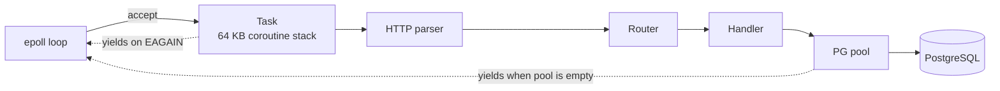

# raw_http_server

An HTTP/1.1 server written from scratch in C. It runs stackful coroutines (`ucontext`) on a single-threaded `epoll` loop and talks to PostgreSQL through its own client: wire protocol v3, SCRAM-SHA-256 authentication, and a connection pool with a wait queue. The only dependency is OpenSSL's libcrypto, for the SCRAM primitives.

A small URL shortener runs on top of it to exercise the whole stack. This is a learning project, not production software: see [Security](#security-sql-injection) and [Known limitations](#known-limitations).

## Benchmark

| Scenario | Endpoint | Concurrency | req/s | p50 (ms) | p99 (ms) | Errors |
|---|---|---|---|---|---|---|
| health | `GET /health` | 13 | 84,062 | 0.13 | 0.38 | 0% |
| shortener | `POST /shorten-url` | 39 | 10,014 | 3.43 | 4.76 | 0% |
| shortener | `GET /get-shortened-url/:id` | 39 | 10,014 | 0.36 | 1.11 | 0% |

*Release build in Docker, limited to 1 CPU and 256 MB. k6 ran on the same machine (AMD Ryzen 7 9700X) over loopback, with a new TCP connection for every request. Memory stayed under 6 MB.*

- **Concurrency** is the smallest number of in-flight requests that gets within 5% of peak throughput. Past it, requests only wait longer. Peak was about 88k req/s on `/health`, and about 10.3k shorten + resolve pairs per second (20.7k req/s) on the shortener.
- **`/health`** never touches the database, so it measures the HTTP layer alone. The event loop is one thread, and it saturates its single core at about 13 concurrent connections.
- **The shortener flow** shortens a fresh URL, then resolves that exact code. Throughput levels off around 40 concurrent flows, which is also the pool size (`DB_POOL_SIZE = 40`); beyond that, requests queue for a connection. Shortening costs more than resolving because the `INSERT` waits for Postgres to commit.

## How a request flows



1. The loop waits in `epoll_wait`. When a client connects, it `accept4`s it as non-blocking, registers it with epoll, and creates a task with its own stack.
2. The loop runs every ready task with `swapcontext`.
3. The task reads the request. If a read returns `EAGAIN`, the task records itself on the socket and **yields** back to the loop. When epoll reports the socket readable, the loop reschedules it.
4. The parser reads the request line, headers and a `Content-Length` body (256 KB max). The router matches the method and path, including `:params`.
5. The handler queries Postgres. If no connection is idle, the task joins the pool's FIFO queue and **yields** until one is released. Postgres sockets are on the same epoll loop, so waiting for the database **yields** too.
6. The response is written (yielding on a full socket buffer) and the connection is closed. The loop then frees the task.

## Quick start

You need Linux, CMake 3.15+, a C23 compiler, OpenSSL headers, and Postgres on `127.0.0.1:5432` using SCRAM-SHA-256 authentication (the default since Postgres 14).

```sql
CREATE TABLE urls (id SERIAL PRIMARY KEY, long_url TEXT NOT NULL, short VARCHAR(10) NOT NULL);
CREATE INDEX short_url_index ON urls (short);
```

The server reads `.env` from its working directory:

```
PORT = 8080
DB_USERNAME = postgres
DB_PASSWORD = secret
DB_NAME = urls
```

```sh
cmake -B build-release -DCMAKE_BUILD_TYPE=Release
cmake --build build-release
./build-release/http_server
# or, with the CPU and memory limits used for the benchmark:
docker compose up --build
```

```sh
curl -X POST --data 'https://example.com' localhost:8080/shorten-url
# Success, shortened URL: https://example.com To: aZ3kQ9xY1b
curl localhost:8080/get-shortened-url/aZ3kQ9xY1b
# Success!, original URL is: https://example.com
```

To reproduce the benchmark: `node loadtest/find_max.mjs`. It runs `loadtest/shortener.js` through a local k6 or the `grafana/k6` Docker image, and binary-searches the concurrency.

## Security: SQL injection

**Don't expose this server to untrusted input.** The handlers build SQL by pasting request data into the query string, and send it with Postgres's *simple query* protocol. That protocol runs every statement in the string, so a crafted body can append statements of its own:

```sh
curl -X POST --data "x', 'y'); DROP TABLE urls; --" localhost:8080/shorten-url
# runs: INSERT INTO urls (long_url, short) VALUES ('x', 'y'); DROP TABLE urls; --', '...');
```

Escaping quotes by hand is fragile. The real fix is parameterized queries, which need the *extended query* protocol: `Parse` sends the SQL with `$1` placeholders, `Bind` sends the values separately, then `Execute` and `Sync`. Postgres never parses the values as SQL, so they can't change the statement. The existing response parser can be reused; only the message sequence is new. This is the next planned feature.

## Known limitations

- **No keep-alive:** every request opens a new TCP connection.
- **No timeouts:** a client that sends slowly holds a task forever, so the server is open to slowloris.
- **No TLS.**
- **No chunked transfer encoding:** requests that use it are rejected.
- **Single-threaded:** one core, whatever the machine has.
- **No guard pages:** coroutine stacks are a plain 64 KB `malloc`, so a stack overflow corrupts the heap instead of crashing cleanly.
- **SQL injection:** queries aren't parameterized yet (see above).

## Layout

```
server/            the engine, built as a static library (rhs)
  runtime/         epoll event loop, coroutine scheduler, async read/write
  http/            request parser, headers, router, responses
  pg/              Postgres client: wire protocol, SCRAM auth, pool, queries
  core/            byte buffers, base64
app/               the URL shortener: main.c and its handlers
env_parser/        .env loader
utils/             shared helpers
loadtest/          k6 script and the concurrency search
```

`app/` includes from `server/`, never the other way round.
